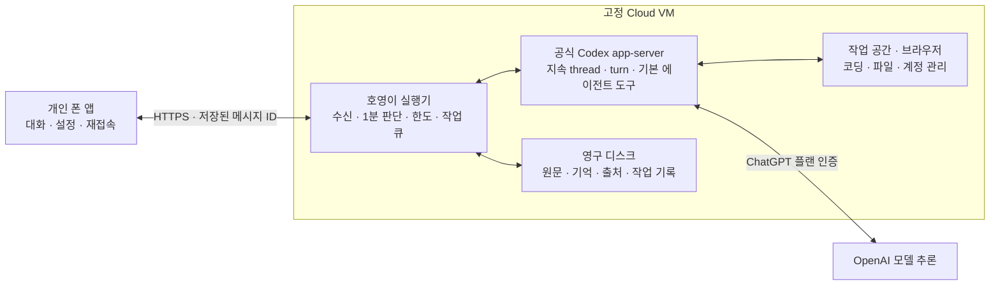

# 호영이의 고정 클라우드 작업 구조

이 문서는 별도 사설 VM을 확보할 수 있을 때의 기존 구현안이다. 사용자는 추가 비용 0원, 상시 PC 없음, 클라우드 영구 유지 포기로 조건을 변경했고 현재 방향은 [Android 앱과 Work Cloud 설계](work-mobile-architecture.md)다. 아래 구현과 테스트는 새 Work 연결이나 무료 실행 장소 확보를 증명하지 않는다.

호영이의 판단·코딩·브라우저 작업은 운영자가 제어하는 한 Cloud VM에서 실행한다. 폰 앱은 대화·사진 입력·설정·진행 표시·조향을 맡는다. 폰의 접속 상태와 대화 세션 변경이 실행 VM이나 작업의 수명을 결정하지 않는다. CLI를 매번 새로 실행하는 대신 VM의 공식 Codex app-server 연결을 유지하고 다음 turn을 전달한다.

AI를 주기적으로 깨우는 기능, 대화·기억의 연속성, 실제 작업 컴퓨터의 수명은 별개다. 이 구조는 세 기능을 같은 운영 VM에 배치하는 구현 선택이며 Codex Cloud의 지속 이용이 불가능하다는 판정이 아니다. 구독 Cloud는 같은 작업의 저장 상태 재개를 지원한다. 전용 앱에서 그 작업을 주기적으로 자동 재개하는 공개 CLI 연결과 실행 중 프로세스의 유지 조건은 아직 확인되지 않았다. 다른 VM에서 저장 상태를 복원하는 방식도 설계할 수 있지만 해당 구독 연결을 실제로 검증한 상태는 아니다.

## 실행 위치

실행기·Codex·작업 파일·브라우저 프로필을 같은 VM에 두면 별도의 원격 executor 할당 API가 필요 없다. 다른 대화를 열어도 작업 장소는 바뀌지 않는다. 폰에서 작업마다 `codex cloud exec`를 호출하지 않으며 구독 Cloud task의 임시 workspace에 영구 작업 상태를 의존시키지 않는다.

## 앱 시작과 작업 흐름

1. 앱이 시작되면 백그라운드에서 Cloud 실행기와 연결하고 상태·최근 대화·진행 중 작업을 불러온다. 화면에는 실제 연결 단계와 진행 상태를 표시한다. 연결 중에도 입력한 메시지는 폰의 재전송 큐에 먼저 저장한다.
2. 각 입력에는 고정 `clientMessageId`를 붙인다. 서버가 메시지·작업을 저장하면 HTTP 응답과 관계없이 Cloud 실행기가 작업을 책임진다. 응답이 유실된 재전송도 같은 ID를 사용하며 다른 내용으로 같은 ID를 재사용하면 거절한다.
3. 실행기는 준비된 Codex 연결에 turn을 시작한다. 명령 접수 응답과 실제 작업 완료를 구분하고 `turn/completed`로 종료를 확인한다. 진행 이벤트는 저장해 앱이 재접속했을 때 이어서 읽는다.
4. 작업 중 새 지시는 현재 turn의 `expectedTurnId`로 steer한다. 기존 작업과 조향 입력을 각각 보존하고, 확인되지 않은 전송 결과를 새로운 작업으로 무조건 반복하지 않는다. 명시적 중단·권한 변경은 사용자 제어로 처리한다.
5. 사용자가 없어도 VM의 60초 판단 주기가 목표·대기 작업·새 사건을 확인한다. 진행 중인 작업과 겹치는 자동 판단을 만들지 않는다. 할당한 책임은 작업 완료 뒤에도 유지한다.

폰의 백그라운드 실행 제한이나 통신 손실은 화면·알림 지연에 영향을 줄 수 있지만 이미 접수된 Cloud 작업을 취소하지 않는다. 앱이 연결돼 있어야만 돌아가는 1분 타이머를 자율성의 유일한 실행 주체로 사용하지 않는다.

## 대화와 실행 환경의 수명

| 항목 | 보존과 재개 방식 |
|---|---|
| Cloud 실행기 | 한 VM의 장기 서비스. 컨테이너·호스트 재시작 시 감독자가 다시 실행 |
| Codex 프로세스 | 실행기가 살아 있는 동안 app-server 연결 유지. 각 메시지마다 새 프로세스를 만들지 않음 |
| 대화와 thread | 앱 대화 ID와 native thread ID의 대응을 디스크에 보존. 새 대화도 같은 VM·작업 공간 사용 |
| 원문과 개인 기억 | 앱 SQLite의 원문·출처·정정 버전 보존. AGENTS.md·native 회상과 함께 사용 |
| 브라우저 로그인 | VM의 영구 프로필에 저장. 실제 프로세스가 종료되면 프로필로 브라우저를 다시 시작 |
| 코딩 프로젝트와 설치 도구 | 영구 작업 공간·설치 디렉터리에 저장. 대화 재시작과 독립 |
| 작업 결과와 전송 기록 | 대기 큐·실행 저널·outbox·메시지 ID로 재접속과 중복 처리 |

같은 프로세스가 살아 있는 앱 재접속과 실제 VM 재부팅은 다르다. 재부팅 뒤 디스크 상태를 복구할 수 있어도 종료된 프로세스의 RAM·열린 소켓이 그대로 돌아온다고 표시하지 않는다. 결과가 불명확한 행동은 기록과 native thread를 확인한 뒤 재개하고 자동 재실행하지 않는다.

## 지침과 확장

맞춤 지침은 공식 Codex 지침 규약을 사용한다. Codex가 파일·셸·에이전트 도구를 직접 수행하고, 호영이는 기억·설정·앱 메시지·목표·영속 브라우저를 native 동적 도구로 연결한다. 이전 JSON 계획과 외부 도구 실행 루프를 native 작업 엔진의 대체물로 사용하지 않는다.

사용자 한 명을 위한 앱이며 회원가입과 사용자 계정 시스템은 만들지 않는다. HTTPS의 기기 연결 키와 Codex 플랜 인증은 별도다. 기존 ChatGPT 플랜을 쓰되 유료 API로 자동 전환하거나 크레딧을 자동 구매하지 않는다. 실제 기능 권한과 계정 이용 한도는 앱의 설정에 따라 처리한다.

## 연결 손실과 한도 처리

| 상황 | 실행 동작 |
|---|---|
| 폰 화면 종료·통신 끊김 | Cloud 작업과 Codex 연결 유지. 앱은 재접속 뒤 상태를 불러옴 |
| 입력 접수 응답 유실 | 같은 메시지 ID로 재전송. 이미 저장된 작업을 새로 만들지 않음 |
| 모델 사용 한도 소진 | 원문·작업·기억 유지, 모델 없는 안내. 읽기 전용 사용량으로 복구 확인 |
| app-server 응답·완료 확인 유실 | 완료라고 표시하지 않음. native 기록으로 확인하거나 불명확한 작업을 보류 |
| 실행기·VM 재시작 | 영구 데이터와 thread 대응 복구. 실행 결과가 불명확한 행동은 검토 후 재개 |

‘끊기면 안 됨’은 폰의 연결 손실과 세션 변경이 Cloud 작업을 종료하지 않는 요구사항으로 구현한다. 실제 호스트 장애와 제공자 중단에서 무중단을 보장하려면 별도 이중화·가용성 계약이 필요하다. 한 VM 구성은 프로세스 감독·영구 저장·복구로 장애 시간을 줄이며 장애가 없었다고 가장하지 않는다.

## 운영 VM 선택

세션별 수명을 관리하는 구독 Cloud task와 운영자가 계속 켜둘 수 있는 VM을 구분한다. Oracle 무료 VM은 확보와 회수 조건을 확인한 뒤 사용할 수 있는 후보다. 연속 운영을 우선하면 사용자가 허용한 월 1만~2만원 범위에서 고정 Cloud VM을 선택한다. 서버 견적·로그인·실제 할당은 배포 단계에서 확인하며 이번 구조 변경으로 유료 자원을 생성하지 않는다.

운영 소스는 최신 코드를 새로 패키지로 만들어야 한다. 과거 Oracle 설치 패키지는 native 상주 엔진을 포함하지 않는다. 연결 설정은 [운영 절차](native-cloud-operations.md)를 따른다.

## 구현 상태

고정 VM에서 실행할 상주 app-server 연결부·native 실행기와 앱 text 재전송을 구현했다. `ASSISTANT_ENGINE=codex-native`로 새 엔진을 선택하며 기존 실행 경로도 보존한다. 전체 테스트 201개가 통과했고 새 빈 Codex home의 실제 무인증 초기화·읽기 전용 설정 조회를 확인했다. Android APK·사진 모델 입력·push·휴대폰 권한 도구와 실제 운영 VM 배포는 별도 개발·검증 대상이다. 테스트의 native 응답 대역은 실제 계정의 작업 수행이나 상시 운영을 증명하지 않는다.

한 데이터 디렉터리는 한 실행기가 운영한다. 동일 SQLite에 두 서비스를 동시에 띄워 작업을 이중 처리하지 않는다. native full access에서 개별 기능 권한을 완전히 격리할 수 없는 조합을 선택하면 새 native turn을 시작하지 않고 상태를 알린다. Native 자동 기억 추출은 사용량·삭제 동기화 검증 전까지 비활성화하며 앱 원문과 출처가 있는 영구기억을 보존한다.

## 공식 동작 근거

- [Codex app-server의 thread와 turn](https://developers.openai.com/codex/app-server)
- [Cloud 작업별 workspace와 저장 상태](https://learn.chatgpt.com/docs/environments/cloud-environments#reuse-and-update-saved-state)
- [Cloud 상태 복구 기간](https://help.openai.com/en/articles/20001545-using-codex-cloud)
- [Cloud CLI의 새 작업 명령](https://github.com/openai/codex/blob/f82e36592278a0a782fb0d0fc97e5fa10e832ac2/codex-rs/cloud-tasks/src/cli.rs#L15)
