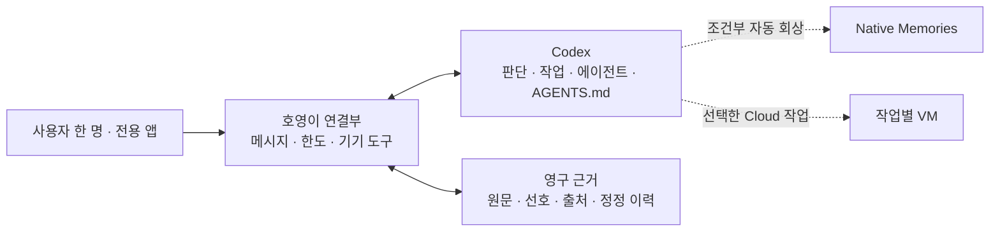

# Codex 기본 기능 활용 검토

2026-10-13 공식 문서와 `openai/codex` 공개 커밋 `f82e36592278a0a782fb0d0fc97e5fa10e832ac2`를 검토했다. 로그인·모델 생성·Cloud 작업 제출은 수행하지 않았다.

최신 범위는 사용자 한 명을 위한 전용 채팅앱이다. 앱 회원가입·로그인 계정, Instagram DM 수신·발신자 권한 구분·읽음은 대화 수단에서 제외한다. Codex 플랜 인증과 공개 서버의 접근 보호는 앱 계정과 별개다. 실행 형태·로컬 기록·인증·한도의 자세한 검토는 [CLI 심층 검토](codex-cli.md)를 따른다.

## 한눈에 보는 호영이 구성

목표는 오래 기억하고 먼저 행동하며, 작업 중에도 주인의 새 지시를 받는 개인 에이전트다. Codex 기본 기능을 우선 활용하고 영구 근거와 대화·기기 연결을 보완한다. 아래의 플랫폼 지원은 현재 앱에서 실제 운영 검증을 마쳤다는 뜻이 아니다.

점선은 연결 조건을 검증해야 하는 기능이다. 현재 앱은 native Memories 자동 학습과 Cloud 작업 제출 경로를 실제 운영에 연결하지 않았다.

| 구현하려는 것 | Codex 기본 지원 | 필요한 보완 | 현재 상태 |
|---|---|---|---|
| 판단·코딩·파일·터미널·설치 | 지원 | 실행 환경과 도구·계정 연결 | 고정 Cloud VM용 native 엔진·기본 도구 연결 구현; 운영 모델 검증 전 |
| 병렬 에이전트·도구 확장 | 지원 | native 도구와 앱 도구 연결 | 새 native 엔진은 Codex 기본 에이전트 도구 사용; 기존 제한 wrapper도 보존 |
| 성격·말투·조사·행동 지침 | AGENTS.md·native 지침 지원 | UI·사용자 대화 설정 동기화 | 기존 AGENTS.md·새 native developerInstructions 연결 구현 |
| 대화에서 배우고 개인화 | Memories 조건부 지원 | 적격 지속 세션과 native 검색·기억 연결 | 자체 기억 보완 완료; native 자동 학습 꺼짐 |
| 오래 안 써도 원문·중요 기억 유지 | 기본 기억만으로 영구 보장 안 됨 | 원문·출처·정정 버전·외부 백업 | 원문 저장·비만료 정책 있음; 운영 백업 검증 전 |
| Cloud 컴퓨터로 작업 | CLI에서도 지원 | 환경 선택·작업·저장 수명 검증 | 명령 확인 완료; 운영 Cloud 작업 미제출 |
| 24시간 매분 판단·선톡 | 기본 도구·예약 일부 지원 | 별도 깨우기·수신·복구·저장; 실행 환경 수명과 분리 | 고정 VM용 60초 native 실행기 구현; 실제 상시 운영 미검증 |
| 작업 중 대화 확인·방향 수정 | app-server의 turn/steer·turn/interrupt 지원 | 앱의 현재 thread/turn·이벤트 연결 | native 조향·완료 이벤트·폰 접속 종료와 작업 수명 분리 테스트 완료 |
| 인스타 같은 앱·사진·알림 | 기본 모바일 Remote 기능은 있으나 원하는 앱과 다름 | 전용 Android UI·첨부·사진 모델 입력·push | 웹 관리 화면 있음; Android 앱/APK 없음 |
| 폰 파일·주소록·알림·앱 조작 | Codex 권한만으로 폰 권한을 얻지 못함 | Android 권한과 기기 도구 연결 | 미구현; 다른 앱의 비공개 파일은 전체 파일 권한으로도 열리지 않음 |
| 다른 사이트·계정 관리 | 브라우저·도구 연결 가능 | 필요한 사이트의 인증·작업별 검증 | 범용 브라우저 코드 있음; Instagram DM은 앱 대화 경로에서 제외 |
| 전용 앱을 한 명만 사용 | 자체 UI 범위 | 앱 회원 계정 없이 사용; 외부 공개 서버만 접근 보호 | 채팅 우선·로컬 로그인 창 없음; Instagram 자동 관측·읽음 꺼짐 |
| UI·대화에서 지침/권한 수정 | Codex 설정 지원; 맞춤 UI는 별도 | 설정 동기화; OS·서비스 권한은 별도 승인 체계 | UI·주인 설정 도구 코드 있음 |
| 한도 소진 답장·복구 | 읽기 전용 account/rateLimits/read 지원 | 모델 없는 안내·작업 보존·중복 방지·검증된 복구 | 구조화 조회·불명확한 복구 보류를 테스트; 운영 계정 미검증 |
| 개인 ChatGPT 목록에 대화 비저장 | 로컬 CLI 기록은 일반 ChatGPT 채팅과 별개 | 로컬 archive 유지; 원격 추론·제공자 보관 구분 | 불필요한 ephemeral 기본값 제거; 실제 생성·계정 화면 미검증 |
| GPT-6.1 Sol·Medium·Fast | 계정·환경에서 제공되면 지원 | 실제 가용 조합과 사용량 확인 | 요청 기본값 반영; 운영 계정 재확인 필요 |
| 별도 API 요금 없이 사용 | ChatGPT 로그인으로 플랜 이용 가능 | 구매 크레딧·자동 충전 상태 확인 | 유료 API fallback 없음; 계정 자동 충전 미확인 |

권장 방향은 공식 `codex app-server`의 지속 대화·기본 작업 엔진을 활용하고, 추가 개발을 전용 앱·영구 근거 저장·Android 도구·한도와 운영 복구에 집중하는 것이다. 별도 서버 필요 여부는 Cloud의 수신·재개·보존 조건을 실제로 확인한 뒤 결정한다. 24시간 상주 서버가 확보됐다고 미리 전제하지 않는다.

### 현재 완료와 미완료

전체 테스트 201개가 통과했다. 고정 Cloud VM용 native 지속 연결·thread·turn·조향·동적 앱 도구·한도·복구와 앱 재전송을 구현했다. 실제 CLI의 새 빈 home에서 무인증 초기화와 설정 조회를 확인했다. 운영 모델 생성, native 자동 Memories, 구독 Cloud 작업의 매분 자동 재개, Android 앱·기기 접근과 상시 운영은 완료 상태가 아니다. [최신 구조](cloud-agent-architecture.md)와 [인수 기록](handoff.md)을 따른다.

### 전체 검토의 추가 1차 자료

- [기본 에이전트 분담](https://learn.chatgpt.com/docs/agent-configuration/subagents)
- [MCP 도구 확장](https://learn.chatgpt.com/docs/extend/mcp)
- [브라우저 실행 위치와 로그인](https://learn.chatgpt.com/docs/browser)
- [작업 중 지시·장기 작업](https://learn.chatgpt.com/docs/long-running-work)
- [모바일 Remote·사진·조향](https://developers.openai.com/blog/mastering-codex-remote-for-engineering)
- [Remote 연결 조건](https://learn.chatgpt.com/docs/remote-connections)
- [Android 파일 접근 범위](https://developer.android.com/training/data-storage/manage-all-files)
- [Android 주소록](https://developer.android.com/identity/providers/contacts-provider)
- [Android 알림 읽기 서비스](https://developer.android.com/reference/android/service/notification/NotificationListenerService)
- [권한과 실행 환경](https://learn.chatgpt.com/docs/permissions)
- [모델 가용성](https://learn.chatgpt.com/docs/models)
- [Fast·추론 속도](https://learn.chatgpt.com/docs/agent-configuration/speed)
- [계정 이용 한도·표준 Cloud VM 비용](https://help.openai.com/en/articles/11369540-using-codex-with-your-chatgpt-plan)
- [크레딧·자동 충전](https://help.openai.com/en/articles/12642688-using-credits-for-flexible-usage-in-chatgpt-personal-plans)

## CLI에서도 Cloud 작업 가능

CLI와 웹·IDE·데스크톱 앱은 같은 Codex harness를 사용한다. CLI에는 `codex cloud exec --env ENV_ID "작업 내용"` 경로가 있어 Cloud 환경에 작업을 제출할 수 있다. 기본 `codex exec`와는 다른 실행 경로이며, 현재 호영이 어댑터는 기본 `exec`를 사용한다. 최신 upstream의 `exec`도 별도로 설정한 원격 exec-server를 사용할 수 있으므로 CLI 실행이 항상 로컬이라고 단정하지 않는다.

Cloud VM은 작업별 자원이다. 계정 접근 권한과 재사용 가능한 published environment는 동일한 VM이 영구 상주한다는 보장이 아니다. 같은 작업을 계속하면 파일·설치 도구·미커밋 변경을 복구할 수 있으며 기본 복구 기간은 마지막 turn 시작·resume 이후 최대 7일이다. 새 작업은 별도 workspace를 사용한다.

현재 공식 문서는 Plus 작업의 기본 VM을 2 vCPU / RAM 8GiB / 디스크 8GiB, Pro·Business·Enterprise를 4 vCPU / 16GiB / 32GiB로 설명한다. 내장 computer/browser use는 현재 Cloud 지원 목록에 없고, 작업 안에서 Playwright 등 별도 프로그램을 설치해 사용하는 것은 따로 검증해야 한다.

- [공식 CLI 명령](https://learn.chatgpt.com/docs/developer-commands?surface=cli#codex-cloud)
- [Cloud VM·상태·현재 제한](https://learn.chatgpt.com/docs/environments/cloud-environments)
- [공유 harness 설명](https://openai.com/index/unlocking-the-codex-harness/)

## 예약 실행의 범위

기존 채팅에서 분 단위 예약 실행은 공식 문서에 있다. 웹 예약은 대화 맥락과 연결 도구를 사용할 수 있지만 로컬 폴더·worktree를 계속 보존하지 않는다. 데스크톱 로컬 프로젝트 예약은 컴퓨터와 앱이 켜져 있어야 한다. CLI 자체에는 Scheduled 관리 화면이 없다. 공식 문서만으로 예약이 특정 Codex Cloud VM을 매분 재개한다고 판단하지 않는다.

현재 연결된 자동화 생성·수정 도구는 최대 시간당 한 번만 허용하며 environment·지속 VM·목적지 thread를 지정하는 입력이 없다. 문서의 UI 기능과 이 도구의 지원 범위를 구분한다. 이번 검토에서 예약을 생성하거나 변경하지 않았다.

ChatGPT Work 예약의 대화는 일반 ChatGPT Recents에 표시될 수 있어 사용자의 채팅 목록 비저장 요청과 함께 평가해야 한다. Codex 로컬 기억, Work의 계정 기억, 각 대화 기록은 서로 다르다.

- [분 단위 예약과 실행 위치](https://learn.chatgpt.com/docs/automations#schedule-a-task-inside-a-chat)
- [ChatGPT Work와 Codex 기록](https://help.openai.com/en/articles/20001275-chatgpt-work-and-codex)

## AGENTS.md와 현재 연결

맞춤 지침은 Codex의 기본 `AGENTS.md` 로딩을 활용한다. 실제 앱은 전용 `/data/codex`를 Codex home으로 지정하며 모델 호출 전에 현재 설정의 지침을 그 안의 `AGENTS.md`에 반영한다. 개인 기본 `~/.codex`는 수정하지 않는다. global `AGENTS.md`는 프로젝트 지침 탐색을 끄더라도 로드된다. 동일한 지침을 stdin에 다시 복사하지 않는다.

UI·주인 대화로 수정한 지침을 파일에 연결하는 얇은 동기화는 필요하지만 별도의 지침 해석 엔진을 개발할 필요는 없다. 파일 쓰기와 native 로딩 규약을 검증한 것과 실제 모델 turn에서 적용을 관측한 것은 구분한다.

- [공식 AGENTS.md 규약](https://learn.chatgpt.com/docs/agent-configuration/agents-md)

## 더 적극적이고 오래 유지하는 기억

기존 SQLite의 원문·기억·버전·출처는 영구 근거 저장소다. 오래됐거나 자주 사용하지 않는다는 이유로 삭제하지 않으며 수정은 이전 버전과 원문을 남긴다. 사용자가 잊기·삭제를 요청한 경우에는 해당 출처와 파생 기록을 함께 처리한다.

주인의 새 메시지마다 선호, 정정, 사람·프로젝트 관계, 결정과 미완료 목표를 검토하고 필요한 것을 출처 ID와 함께 기록하도록 지침을 강화한다. 단순 잡담이나 확인되지 않은 추측은 영구 사실로 만들지 않는다. 오래된 필수 주인 요구사항은 최근 기억 개수 제한 때문에 밀려나지 않도록 별도로 회수한다. 현재 작업의 원문 ID가 최근 대화 범위 밖에 있어도 직접 찾아 전달한다. 요약이 부족하거나 충돌하면 원문 검색으로 확인한다.

Codex Memories는 유용한 회상 계층이지만 전체 원문을 무손실 보존하는 기능은 아니다. 검토한 소스에는 사용하지 않는 기억을 정리하는 동작이 있고 `max_unused_days`는 0~365일로 제한된다. 0은 영구 보관을 뜻하지 않는다. 주인 신원·필수 지침과 장기 근거는 AGENTS.md·원문 저장소에서 유지한다.

현재 어댑터의 `codex exec`는 native 자동 기억 추출 대상이 아니다. 이번에 정상 로컬 기록을 유지하도록 `--ephemeral` 기본값을 제거했지만 이 변경만으로 자동 학습이 연결되지는 않는다. 공식 app-server의 적격 지속 thread 등으로 연결을 바꾸고 기억 읽기·검색·추출을 검증해야 native 자동 Memories를 사용할 수 있다. 현재 활성 thread는 자동 추출에서 제외되므로 같은 대화 하나만 계속 쓰면 자동 학습이 된다고 가정하지 않는다. 별첨 설정은 다음 연결을 위한 준비본이며 현재 어댑터에 적용된 설정이 아니다.

Native 기억을 연결할 때는 자체 저장소의 잊기 요청을 native 원문·기억에도 반영해야 한다. native 기억 reset만 수행하면 원본 thread에서 다시 학습할 수 있다. 검증 전에는 자동 native 학습, 무한 기억, 100% 회상이나 상시 VM 운영이 완료됐다고 표시하지 않는다.

- [공식 Memories 설명](https://learn.chatgpt.com/docs/customization/memories?surface=cli)
- [현재 소스의 기억 설정·제한](https://github.com/openai/codex/blob/f82e36592278a0a782fb0d0fc97e5fa10e832ac2/codex-rs/config/src/types.rs)
- [추출 대상 session source](https://github.com/openai/codex/blob/f82e36592278a0a782fb0d0fc97e5fa10e832ac2/codex-rs/rollout/src/lib.rs)
