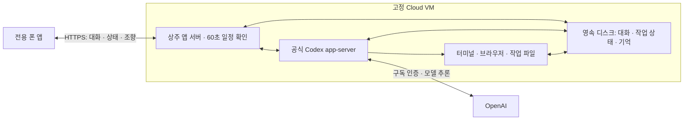

# 고정 Cloud VM의 네이티브 Codex 운영

호영이의 작업 엔진은 계속 켜진 Linux Cloud VM에서 실행하고, 폰 앱은 대화·설정·진행 상황을 연결한다. 폰 화면을 끄거나 앱을 닫거나 통신이 끊겨도 VM의 작업은 종료하지 않는다. `codex app-server`는 그 VM에 설치한 공식 Codex 프로세스다. 이 명령이 구독에 포함된 별도 Cloud VM을 할당하는 것은 아니다.



## 세션과 VM의 수명

대화 ID와 작업 ID는 VM ID와 별개다. 같은 VM의 같은 작업 경로에서 `thread/start` 또는 `thread/resume`을 실행한다. 대화를 새로 만들었다는 이유로 컨테이너를 새로 만들거나 `codex cloud exec`로 새 Cloud 작업을 제출하지 않는다. 공식 `app-server`의 대화·턴 제어를 사용한다. [공식 프로토콜](https://learn.chatgpt.com/docs/app-server)

60초 타이머는 VM의 앱 서버가 실행한다. 새 지시·예약 시각·복구 대상 등을 먼저 확인하고 필요할 때 Codex에 다음 턴을 요청한다. 이미 작업 중이면 같은 진행 중 작업에 조향을 전달하거나 다음 요청으로 저장한다. 타이머마다 진행 중 작업을 중단하고 엔진을 새로 시작하지 않는다. 한도 소진 상태에서는 모델을 호출하지 않는 사용량 조회로 복구 여부를 확인한다.

한 영속 데이터 디렉터리에는 실행기 하나만 운영한다. 동일 SQLite와 native thread 대응을 사용하는 서비스를 동시에 두 개 실행하지 않는다. 앱이 새 대화를 여는 것은 새로운 실행기 서비스를 켜는 동작이 아니다.

| 상황 | 운영 동작과 보존 범위 |
|---|---|
| 폰 앱 종료·화면 꺼짐·폰 통신 끊김 | Cloud worker를 그대로 둔다. 폰은 재접속 후 저장된 진행 상태를 읽는다. |
| 새 대화·이전 대화 재개 | 동일 VM·동일 영속 작업 경로를 사용한다. |
| 모델 한도 소진 | 작업·입력·대화는 보존하고 모델 판단을 대기한다. 한도 안내는 모델 없이 반환한다. |
| 엔진 또는 앱 프로세스 종료 | 감독 프로세스가 다시 시작하고 저장된 대화·작업 상태를 읽는다. 실행 중인 RAM·브라우저 연결 자체는 복원되지 않는다. |
| VM 재부팅 | 같은 영속 디스크에서 서비스를 다시 시작한다. 진행 중이던 외부 작업은 결과를 확인한 뒤 재개한다. |
| Cloud VM·디스크 장애 | 별도 백업에서 새 호스트로 복원한다. 백업 이후의 미저장 변경과 진행 중 프로세스는 보장할 수 없다. |

폰 연결 종료는 종료 명령으로 취급하지 않는다. 작업 중단은 사용자의 명시적 중단, 앱 운영자의 정상 종료, 엔진 오류처럼 구분되는 사건으로 기록한다. 시작 요청이 서버에 도착했는지 불명확한 경우 같은 작업을 자동으로 새로 제출하면 안 된다. 외부 전송·결제·게시가 이미 실행됐을 수 있으므로 기존 작업 결과를 먼저 조회한다.

## 영속 디스크

현재 Compose는 `/data`를 영속 저장한다. 루트 [compose.yaml](../compose.yaml)은 이름 있는 `assistant-data` 볼륨을 쓰며, Oracle [compose.yaml](../deploy/oracle/compose.yaml)은 호스트의 `./data` 디렉터리를 `/data`에 연결한다.

| 경로 | 보존할 내용 |
|---|---|
| `/data/assistant.sqlite` | 앱 대화, 설정, 기억, 일정, 작업 상태와 이벤트 |
| `/data/workspace` | 에이전트 작업 파일과 프로젝트 |
| `/data/codex` | 앱 전용 `CODEX_HOME`, 공식 로그인 상태, 지침, 네이티브 세션 기록 |
| `/data/browser/<owner>` | 앱 브라우저의 디스크 프로필. `BrowserTools`가 용도별 하위 디렉터리를 만든다. |
| `/data/python-venv`, `/data/npm` | 영속 디스크에 설치한 Python·Node 도구 |

엔진에 전달하는 `CODEX_HOME`은 `DATA_DIR/codex`, 기본 작업 경로는 `DATA_DIR/workspace`와 일치시킨다. 운영 데이터 경로를 개발 환경의 기존 인증 경로로 바꾸지 않는다. `PERSIST_CODEX_AUTH=true`는 기존 배포 시작 스크립트가 새 Codex 경로를 영속 볼륨에 연결하도록 한다. 기존 설정 경로가 있으면 자동으로 덮어쓰지 않는다.

브라우저 프로필 파일을 보존하는 것과 실행 중 탭·프로세스를 보존하는 것은 다르다. 호스트 재부팅 후 로그인 쿠키가 남을 수 있어도 사이트의 만료·추가 인증이 있으면 다시 인증해야 한다. 네이티브 Codex 도구나 별도 브라우저 도구를 추가할 때도 해당 프로필이 `/data` 안에 있어야 한다.

## 배포 실행

새 고정 VM에서 루트 Compose를 사용할 때:

```sh
cp deploy/native-cloud-worker.env.example .env
chmod 600 .env
# 비공개 편집기로 APP_AUTH_TOKEN을 설정한다.
# 외부 HTTPS 프록시 또는 개인 VPN을 연결한다.
docker compose config --quiet
docker compose up -d --build
docker compose ps
curl --fail --silent --show-error http://127.0.0.1:8080/api/health
```

이미 운영 중인 `.env`가 있으면 복사 명령으로 덮어쓰지 말고 `ASSISTANT_ENGINE=codex-native`와 영속 경로만 검토한다. 전체 `docker compose config` 출력이나 `.env`를 공유하면 접속 키가 노출될 수 있다. `APP_AUTH_TOKEN`은 원격 기기 연결을 제한하는 키이며, 앱 회원가입·사용자 계정 데이터베이스를 만드는 기능은 아니다. 초기 기기 연결 뒤 앱은 이 키를 보관하여 재사용한다. Codex 구독 인증은 이 키와 별개로 배포된 worker에서 최초 한 번 진행한다.

Oracle 설치 경로를 이미 마련한 경우 [기존 설치 절차](oracle-free.md)를 사용하고 `/opt/hoyoung/.env`에 엔진 선택을 추가한다. 기존 설치 스크립트는 `./data:/data`, Caddy HTTPS, Docker 재시작 정책과 부팅 시 시작을 구성한다. 이전에 준비한 설치 아카이브가 최신 네이티브 구현을 포함한다고 가정하지 말고, 검증한 최신 소스를 다시 패키징한 뒤 설치한다.

컨테이너 없이 Linux 호스트에서 확인할 때는 Node 24와 공식 Codex CLI를 설치하고 다음처럼 기존 `npm start`를 사용한다. 이 명령은 로컬 인터페이스만 연다. 실제 상주 운영에는 호스트 서비스 감독과 HTTPS/VPN 연결이 필요하다.

```sh
DATA_DIR=/opt/hoyoung/data CODEX_HOME=/opt/hoyoung/data/codex ASSISTANT_ENGINE=codex-native HOST=127.0.0.1 PORT=8080 npm start
```

`restart: unless-stopped`는 종료된 컨테이너와 호스트 재부팅 후 복구를 지원한다. 수동으로 중지한 컨테이너는 자동으로 켜지지 않는다. Docker `HEALTHCHECK`의 `unhealthy` 판정만으로 실행 중인 컨테이너가 재시작되는 것은 아니다. 엔진 무응답은 별도로 감지하고, 요청 결과가 불확실한 작업을 기록한 뒤 엔진을 다시 연결해야 한다. [Docker 재시작 정책](https://docs.docker.com/engine/containers/start-containers-automatically/)

## 준비 완료와 실제 상태 확인

`/api/health`의 HTTP 200·`ok: true`는 앱 서버 응답 확인이다. 모델 로그인·한도·네이티브 엔진 연결·브라우저 작업 성공까지 증명하지 않는다. 관리 상태에서 엔진 준비 상태, 현재 작업 ID, 마지막 진행 이벤트, 한도 복구 관측을 각각 확인한다. 폰의 로딩 화면도 접속 중·엔진 시작 중·인증 필요·한도 대기·작업 진행을 실제 서버 상태에서 구분해 표시해야 한다.

실제 배포 검증은 폰 연결을 끊은 동안 작업이 계속되는지, 새 대화에서도 같은 작업 파일을 읽는지, 재부팅 후 기록이 남는지, 중단된 외부 작업을 중복 실행하지 않는지를 확인한다. 실제 계정 로그인·모델 응답·장시간 운영을 검증하기 전에는 ‘24시간 가동 검증 완료’라고 보고하지 않는다.

현재 문서와 환경 예시는 배포 준비다. 이번 작업에서 VM을 추가 할당하거나 유료 전환하거나 계정 로그인 또는 실제 모델 턴을 실행하지 않았다.

## 백업과 장애 범위

정상 운영에서는 영속 디스크와 별도로 비공개 off-host 백업을 구성한다. 기존 [백업 기능](deployment.md#기억과-브라우저-데이터-백업)은 SQLite online backup과 파일 스냅샷을 사용한다. 실행 중 브라우저의 여러 파일을 복사한 백업은 완전한 일관성을 보장하지 않으므로 프로필 이전에는 정상 종료 뒤 스냅샷을 사용한다. Codex 로컬 기록·인증·백업도 앱 SQLite와 함께 보존되므로 앱의 기억 삭제가 모든 네이티브 기록·백업·제공자 보관 삭제를 자동으로 뜻하지 않는다.

무료 Oracle 후보는 기존에 준비했지만 용량 확보가 필요하며, 공식 정책상 유휴 Always Free VM은 회수될 수 있다. 항상 같은 VM이 절대 중단되지 않는다는 보장은 아니다. 연속 운영을 우선하면 허용한 월 1만~2만원 범위의 고정 VPS도 검토하되, 가격·디스크·회수 정책·백업을 확인한 후 결정한다. 이 문서는 구매나 요금 변경을 수행하지 않는다. [Oracle Always Free 용량·유휴 회수 정책](https://docs.oracle.com/en-us/iaas/Content/FreeTier/freetier_topic-Always_Free_Resources.htm)

## 폰 앱의 역할

앱 시작 시 백그라운드로 Cloud worker에 연결하고, 저장된 대화 화면은 바로 연다. 통신이 끊긴 동안 새 입력은 로컬 전송 대기 상태로 두며, 재접속 후 같은 메시지 ID로 전달하고 서버 수신 상태를 확인한다. 브라우저 UI의 text 재전송·접수 응답 유실 뒤 중복 방지는 구현·테스트했다. Android APK·푸시 알림·사진은 별도 구현과 실기 검증 대상이다.

Android WorkManager의 반복 작업은 최소 15분이고 실행 시각도 OS 조건에 따라 달라진다. Android 15 이상을 대상으로 하는 `dataSync` 등의 foreground service에는 백그라운드 누적 시간 제한이 있다. 따라서 1분 자율 판단을 폰의 영구 타이머에 의존하지 않는다. 폰은 UI·알림·기기 정보 연결을 담당하고 Cloud worker가 일정을 유지한다. [Android 반복 작업](https://developer.android.com/develop/background-work/background-tasks/persistent/getting-started/define-work), [foreground service 시간 제한](https://developer.android.com/develop/background-work/services/fgs/timeout)
