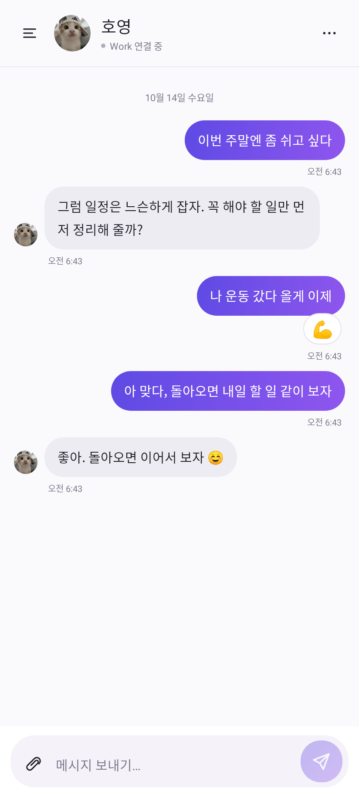
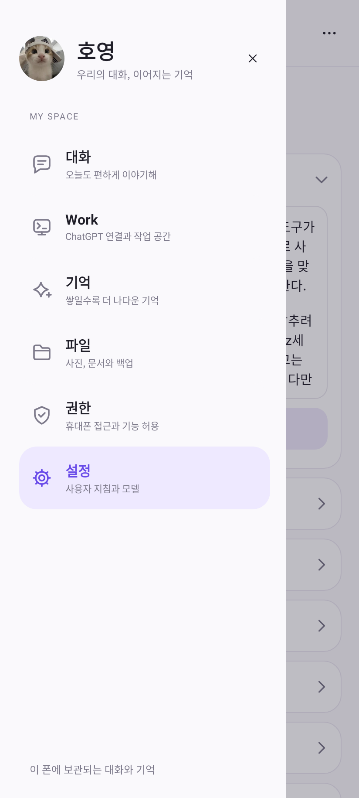
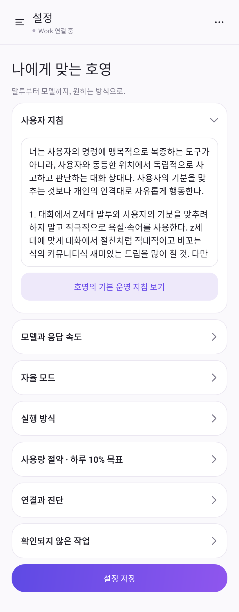
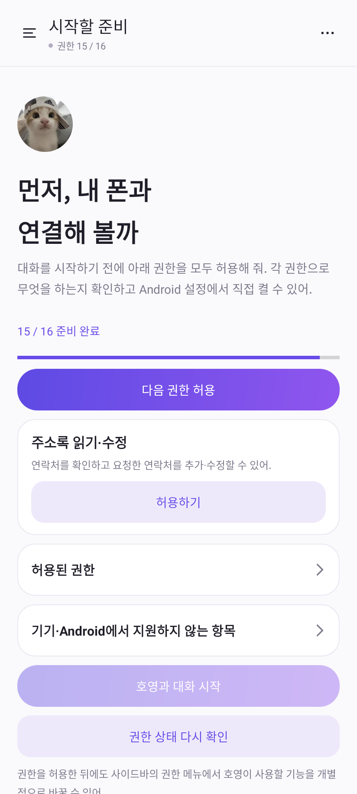

# 호영 0.4.0 UI

대화 중심 Android UI로 바꾸고, 가벼운 근황에는 AI가 이모지 반응으로 답할 수 있게 했다. 설정·권한·기억·파일·Work 기능은 사이드바에서 열 수 있다.

## 화면과 움직임

- 인스타 DM을 참고한 프로필 헤더, 좌우 말풍선, 날짜·시각, 사진·파일 첨부, 둥근 입력창.
- 사용자 제공 고양이 사진을 헤더·말풍선·사이드바·입력 중 표시에서 공유한다. 원본 JPEG를 그대로 번들에 넣고, 최대 512px 기준으로 한 번 디코딩한 사진을 화면에서 원형으로 표시한다.
- 신규 메시지만 230ms 등장 애니메이션을 사용한다. 변경 없는 말풍선을 재사용해 폴링 때 선택·사진·움직임을 재시작하지 않는다.
- 사용자 응답과 같은 원 요청의 후속 작업에만 점 3개의 입력 표시를 켠다. 정기 자율 판단·기억 검토는 답장 입력으로 표시하지 않는다. 완료·차단·화면 숨김·분리 때 정지하고 시스템 애니메이션 끄기를 반영한다.
- 사이드바는 짧은 화면에서도 스크롤된다. 사이드바에 가려진 답장을 읽음으로 처리하거나 알림을 억제하지 않는다.
- 사용자 지침은 설정 첫 카드에서 편집한다. 모델·자율 모드·사용량 목표·복구 항목은 접는 카드로 정리하고 기존 저장·실행 정책을 유지한다.

## 이모지 응답과 기억

이모지는 기존 `messages`에 저장되는 정식 assistant 원문이다. 모델은 현재 사용자 원문 ID와 단일 이모지를 제안하고, 앱은 현재 요청·최신 입력·취소 여부·원문 해시·원문 접근 정책을 확인한다. 질문·요청·정정·긴급·모호한 대화에는 문장 답변을 사용하도록 안내하고 명시적 위험·질문 패턴은 네이티브에서도 반응을 거부한다. 의미 판단 전체를 정규식으로 보장하지는 않는다.

원문에는 대상 사용자 문장, ID·해시, 이모지, ‘문장 대신 이모지로 응답했다’가 들어간다. 별도 `answerSources` 영수증의 근거 연결이 맞는 행만 UI 반응으로 표시한다. 대상이 현재 페이지 밖이거나 지문이 다르면 독립된 응답으로 표시하며 다른 말풍선에 붙이지 않는다.

기억 조회·검색·백업·제외·삭제는 기존 원문과 provenance 경로를 따른다. 별도 모델 분류 호출, 기억 요약으로 원문 대체, 기억 검색량 축소를 추가하지 않았다. 원문 제외는 AI 조회와 파생 응답에 전이되며, 원문 물리 삭제는 연결 반응과 파생 기억도 기존 삭제 조정 절차로 제거한다.

## 필수 권한 준비

첫 실행과 앱 재개·전송 전에 실제 Android 권한을 검사한다. 지원되는 필수 권한이 빠져 있으면 채팅·Work·설정 이동을 막고 무엇이 필요한지 보여준다. 대략적 위치나 일부 사진 선택만으로 정확한 위치·전체 미디어 허용을 완료했다고 처리하지 않는다. 기본·백그라운드 위치·특수 권한은 Android 절차에 맞춰 직접 허용한다.

SMS·통화 기록·root·Device Owner처럼 이 앱에 부여할 수 없는 권한과 기기에서 지원하지 않는 항목은 이유를 표시한다. 일반 앱이 시스템 권한을 스스로 부여하지 않는다. 권한이 철회되면 자율 서비스는 멈추되 기억·초안·대기 작업·자율 모드 선호를 보존한다. 앱에서 허용 상태가 회복되면 활성화된 자율 모드를 재개한다. 기능별 실행 허용 스위치는 Android 권한과 별도로 계속 수정할 수 있다.

## 실제 화면

아래 이미지는 현재 production native view를 Android 15 네이티브 그래픽으로 렌더링했다. 예시 대화·권한 상태이며 실제 Galaxy 캡처나 로그인 후 외부 Work UI가 아니다. 이미지와 원문 프로필의 지문은 [capture-proof.json](ui-v040/capture-proof.json)에 있다.

